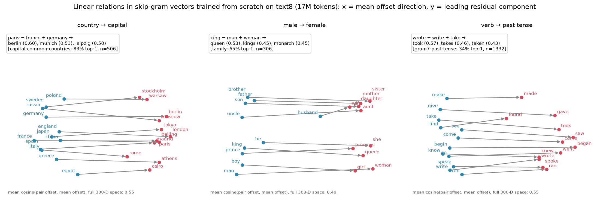
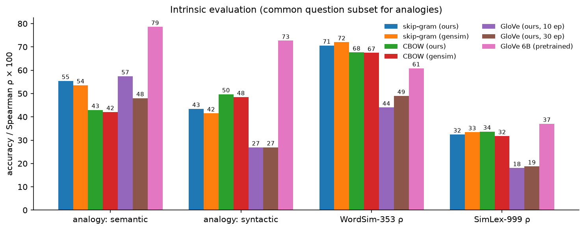
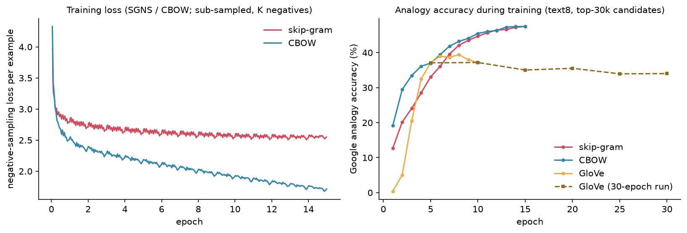
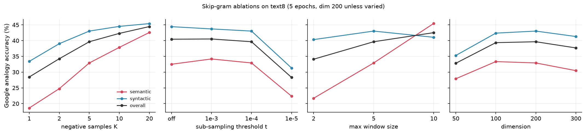
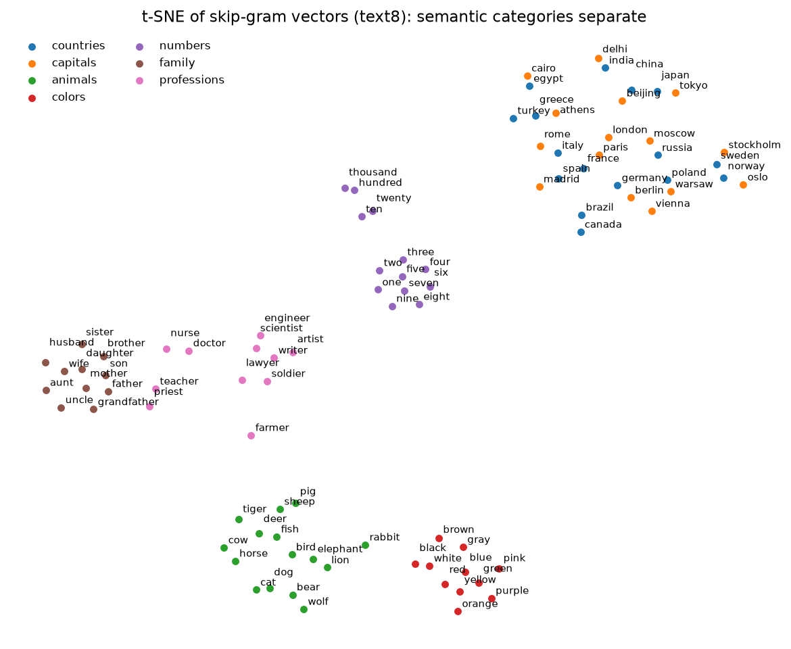
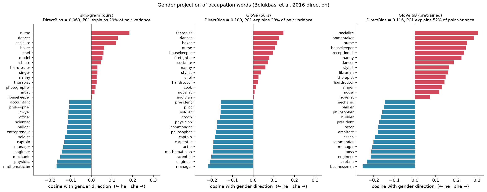

# word2vec-from-scratch

Skip-gram, CBOW (negative sampling, sub-sampling) and GloVe written from scratch in PyTorch, trained on text8 and checked against `gensim` and pretrained GloVe on the Google analogy set, WordSim-353 and SimLex-999.

[](https://github.com/Jai-Advitheeya-Lella/word2vec-from-scratch/actions/workflows/tests.yml)



*Skip-gram vectors trained here on text8 (17M tokens): country → capital, male → female and verb → past-tense pairs. The x-axis is the mean offset direction of the pairs, the y-axis the leading remaining component, so parallel arrows mean consistent offsets. The number under each panel is the mean cosine between each pair's offset and the mean offset in the full 300-D space (1.0 would be perfectly parallel); the box shows one analogy and the top-1 accuracy of the whole Google-analogy section.*

This is a from-scratch reimplementation for learning and research. The training loops, sampling, vocabulary, co-occurrence counting, gradients and evaluation code are written here; `gensim` and the pretrained GloVe vectors are used only as reference points.

## Highlights

- **Word2vec with hand-derived gradients.** Skip-gram and CBOW with negative sampling use closed-form gradients (no autograd) applied with scatter-add SGD on minibatches, the batched analogue of word2vec.c's per-pair updates. The gradients are checked against `torch.autograd` and finite differences.
- **`word2vec.c`-style data pipeline on the GPU.** Frequent-word sub-sampling, a per-position dynamic window, a unigram^0.75 noise distribution sampled by inverse CDF, and a global shuffle, all as a handful of tensor ops (about 56M skip-gram pairs per epoch of text8).
- **GloVe from a co-occurrence matrix built here.** Symmetric, 1/d-weighted counts (46.4M non-zeros for window 10), weighted least squares, and a sort-free sparse AdaGrad. Includes a log of what diverged and what fixed it.
- **Evaluation protocol identical to gensim.** The analogy accuracy of the evaluator matches `gensim`'s `evaluate_word_analogies` exactly on random vectors (unit test), with 3CosAdd and 3CosMul.
- **Bias probing.** Bolukbasi et al. gender direction, occupation projections and DirectBias for the trained and the pretrained vectors.

## Results

Corpus: text8 (17,005,207 tokens), `min_count=5` gives a 71,290-word vocabulary and 16,718,844 training tokens. All models are 300-dimensional. Skip-gram, CBOW and the gensim baselines use window 5, 10 negatives, sub-sampling `t=1e-4` and 15 epochs; GloVe uses window 10 (see below). Hardware: one RTX 5070 Ti that was shared with other jobs the whole time, so wall-clock times are indicative only (peak GPU memory: 0.95 GB skip-gram, 0.64 GB CBOW, 1.0 GB GloVe).

Analogy protocol (as in word2vec.c and gensim): unit vectors, 3CosAdd, candidates restricted to the 30k most frequent words, and the three query words are excluded. Only the 12,268 of 19,544 questions whose four words are all within the 30k most frequent text8 words are used, for **every** model including the pretrained one, so the numbers are comparable (the pretrained GloVe vocabulary is 400k words but is scored on the same questions).

| Model | semantic | syntactic | analogy (all) | WordSim-353 ρ | SimLex-999 ρ | train time |
|---|---|---|---|---|---|---|
| skip-gram (ours) | 55.4 | 43.4 | **47.4** | 0.706 | 0.325 | 7.9 min |
| skip-gram (gensim 4.4) | 53.6 | 41.5 | 45.6 | 0.720 | 0.334 | 21 min |
| CBOW (ours) | 43.0 | 49.7 | **47.5** | 0.677 | 0.337 | 2.6 min |
| CBOW (gensim 4.4) | 42.1 | 48.5 | 46.3 | 0.675 | 0.318 | 3.3 min |
| GloVe (ours, 10 epochs) | 57.4 | 26.9 | 37.1 | 0.440 | 0.181 | 2.9 min + 2.4 min counting* |
| GloVe (ours, 30 epochs) | 48.0 | 27.0 | 34.0 | 0.490 | 0.188 | 30 min |
| GloVe 6B-300d (pretrained, 6B tokens) | 78.6 | 72.7 | 74.6 | 0.609 | 0.371 | – |

\* The 46.4M-entry co-occurrence matrix is counted once on the CPU (142 s) and cached. The gensim skip-gram time (4 worker threads) was measured while the CPU was heavily loaded by other jobs and is inflated.

Analogy accuracies are percentages; WordSim-353 and SimLex-999 are Spearman correlations over the pairs covered by each vocabulary (99.4% and 99.3% for text8). 3CosMul gives 46.4 / 44.2 / 36.7 overall for skip-gram / CBOW / GloVe (full table in `results/metrics.json`).



What the numbers say:

- **Our skip-gram and CBOW match gensim's** at identical hyper-parameters: slightly ahead on analogies (+1.9 and +1.1 points from the unrounded scores), slightly behind for skip-gram on WordSim-353 and SimLex-999 (0.706 vs 0.720 and 0.325 vs 0.334), ahead for CBOW on SimLex (0.337 vs 0.318). The seed-to-seed spread of a single configuration is about 1 point of analogy accuracy (see the ablations), so read this as "equivalent", not "better". Our versions use minibatches of 1024 pairs and a sampler that draws negatives exactly from the unigram^0.75 distribution instead of word2vec.c's 100M-entry table.
- **Skip-gram wins on semantics, CBOW on syntax** (55.4 vs 43.0 semantic, 43.4 vs 49.7 syntactic), the known pattern from Mikolov et al. (2013a). CBOW trains about 3x faster because it makes one update per centre word instead of one per (centre, context) pair.
- **GloVe underperforms on this small corpus.** Its semantic accuracy is competitive (57.4), but syntactic accuracy and the similarity benchmarks are much lower than skip-gram's. The GloVe paper's best numbers come from a 6B-token corpus (the pretrained reference scores 74.6 here, with 350x more data); on 17M tokens the count-based model is less data-efficient, and our run used a single, lightly tuned setting. The objective keeps going down (0.0257 per entry at epoch 10, 0.0204 at epoch 30) while analogy accuracy peaks at epoch 8 of the 10-epoch run (39.4%, evaluated every epoch) and then falls (37.2% at epoch 10 and 34.0% at epoch 30 of the 30-epoch run): fitting the sparse co-occurrence counts further overfits. The "10 epochs" row was chosen by looking at this analogy curve, so it is slightly optimistic for GloVe.
- **Pretrained GloVe is far ahead on analogies (74.6 vs 47.5) and modestly ahead on SimLex-999 (0.371 vs 0.337), but not on WordSim-353** (0.609, below all four word2vec models here). I did not investigate why; WordSim-353 mixes similarity with relatedness, which may favour different training corpora.



### Per-section analogy accuracy

| section | n | skip-gram | CBOW | GloVe (10 ep) | gensim skip-gram | GloVe 6B |
|---|---|---|---|---|---|---|
| capital-common-countries | 506 | 83.0 | 70.8 | 79.1 | 80.2 | 95.3 |
| capital-world | 1452 | 61.2 | 47.0 | 60.1 | 57.7 | 95.4 |
| currency | 268 | 19.4 | 20.1 | 7.8 | 18.7 | 17.8 |
| city-in-state | 1571 | 45.4 | 27.9 | 53.3 | 44.4 | 61.2 |
| family | 306 | 65.4 | 75.2 | 73.2 | 67.6 | 93.8 |
| gram1-adjective-to-adverb | 756 | 12.3 | 11.1 | 1.5 | 9.9 | 23.2 |
| gram2-opposite | 306 | 15.4 | 25.5 | 7.8 | 12.1 | 38.2 |
| gram3-comparative | 1260 | 47.9 | 67.4 | 29.1 | 46.7 | 88.3 |
| gram4-superlative | 506 | 28.5 | 47.8 | 15.8 | 28.5 | 79.9 |
| gram5-present-participle | 992 | 21.7 | 34.5 | 12.4 | 19.1 | 68.7 |
| gram6-nationality-adjective | 1371 | 88.2 | 80.7 | 66.1 | 85.8 | 100.0 |
| gram7-past-tense | 1332 | 34.5 | 40.1 | 16.9 | 32.9 | 62.9 |
| gram8-plural | 992 | 57.6 | 55.9 | 37.5 | 54.9 | 83.3 |
| gram9-plural-verbs | 650 | 31.5 | 41.2 | 13.7 | 30.5 | 57.7 |

### Ablations (skip-gram, 5 epochs, 200 dimensions unless varied)

| setting | value | pairs / epoch | semantic | syntactic | overall | WordSim-353 ρ |
|---|---|---|---|---|---|---|
| negatives K | 1 | 56M | 18.6 | 33.4 | 28.4 | 0.660 |
|  | 2 | 56M | 24.7 | 39.0 | 34.2 | 0.672 |
|  | **5** | **56M** | **32.9** | **43.0** | **39.6** | **0.693** |
|  | 10 | 56M | 37.9 | 44.5 | 42.3 | 0.690 |
|  | 20 | 56M | 42.6 | 45.4 | 44.5 | 0.680 |
| sub-sampling t | off | 100M | 32.5 | 44.4 | 40.4 | 0.683 |
|  | 1e-3 | 75M | 34.2 | 43.7 | 40.5 | 0.673 |
|  | **1e-4** | **56M** | **32.9** | **43.0** | **39.6** | **0.693** |
|  | 1e-5 | 33M | 22.3 | 31.3 | 28.3 | 0.673 |
| max window | 2 | 28M | 21.7 | 40.3 | 34.1 | 0.638 |
|  | **5** | **56M** | **32.9** | **43.0** | **39.6** | **0.693** |
|  | 10 | 103M | 45.5 | 41.1 | 42.5 | 0.710 |
| dimension | 50 | 56M | 27.9 | 35.3 | 32.8 | 0.673 |
|  | 100 | 56M | 33.3 | 42.4 | 39.4 | 0.685 |
|  | **200** | **56M** | **32.9** | **43.0** | **39.6** | **0.693** |
|  | 300 | 56M | 30.5 | 41.3 | 37.7 | 0.683 |



Bold rows are the shared default configuration (identical runs, hence identical numbers). Accuracies are percentages on the same 12,268-question subset as above; "pairs / epoch" is the number of training pairs the run actually saw per epoch (from the training logs). Each run took 34-110 s on the shared RTX 5070 Ti.

Reading the table needs two caveats. **Noise:** repeating the default configuration with seeds 0, 1 and 2 gives 39.6 / 38.7 / 39.4 overall (semantic 32.9-34.7, syntactic 40.7-43.0, WordSim-353 0.693-0.700; `results/seed_variance.json`), so differences of about a point are not meaningful, and every other grid point is a single seed. **Training volume:** the sweeps fix the number of epochs, not the number of updates, so sub-sampling and window size also change how much each run trains (28M to 103M pairs per epoch).

Within those limits: more negatives help steadily at 5 epochs (K=1 to 20: 28.4 to 44.5 overall), mostly through semantic accuracy. A wider window moves accuracy from syntactic to semantic (window 2 to 10: semantic 21.7 to 45.5, syntactic 40.3 to 41.1) and gives the best WordSim-353 (0.710), but it also trains on 3.7x more pairs, and I did not separate the two effects. Sub-sampling at 1e-3 or off is on par with 1e-4 (40.5 and 40.4 vs 39.6, within noise) while 1e-5 discards too much (28.3). Dimension saturates around 100-200; 300 is 1.9 points below 200, about twice the seed range, which may be a real under-training effect at 5 epochs or noise (not tested). The main models (K=10, window 5, t=1e-4, 15 epochs) were not tuned with this grid, and K=20 or window 10 would probably score higher at 5 epochs; I did not re-train the 15-epoch models with them.

### Nearest neighbours

Top-6 cosine neighbours (query excluded, 30k most frequent words):

| word | skip-gram (ours) | GloVe (ours, 10 ep) | GloVe 6B (pretrained) |
|---|---|---|---|
| **king** | kings, queen, crowned, valois, shalmaneser, tiglath | son, henry, iii, queen, iv, ii | queen, prince, monarch, kingdom, throne, ii |
| **france** | french, spain, italy, germany, belgium, paris | germany, spain, britain, italy, french, paris | french, paris, belgium, spain, italy, germany |
| **computer** | computers, hardware, computing, software, minicomputer, microcomputer | computers, hardware, software, systems, graphics, atanasoff | computers, software, pc, technology, computing, laptop |
| **apple** | macintosh, iic, iigs, iie, imac, wozniak | iic, macintosh, mac, iigs, os, microsoft | iphone, macintosh, ipod, microsoft, ipad, intel |
| **music** | musical, jazz, musicians, folk, songs, rockabilly | musical, pop, folk, rock, classical, carnatic | musical, songs, dance, pop, recording, jazz |
| **good** | bad, excellent, poor, luck, evil, bye | bad, things, better, friday, you, very | better, really, always, you, well, excellent |
| **run** | runs, running, ran, operate, inning, batted | runs, running, home, ran, programs, off | runs, running, ran, go, allowed, going |
| **einstein** | relativity, bose, gravitation, physics, electrodynamics, planck | albert, bose, relativity, planck, theory, hofmann | relativity, physicists, freud, equations, theory, physics |

text8 is a 2006 Wikipedia snapshot, which is why "apple" is about the Macintosh and "king" about medieval rulers.



### Embedding bias (gender direction)

The gender direction is the first principal component of the centred definitional pairs (she/he, her/his, woman/man, mary/john, herself/himself, daughter/son, mother/father, gal/guy, girl/boy, female/male), as in Bolukbasi et al. (2016). DirectBias is the mean absolute cosine of ~70 occupation words with that direction.

| embeddings | DirectBias | variance explained by PC1 of the pairs |
|---|---|---|
| skip-gram (ours, text8) | 0.069 | 29% |
| GloVe (ours, text8) | 0.100 | 28% |
| GloVe 6B (pretrained) | 0.116 | 52% |



Every embedding places *nurse*, *dancer* and *socialite* on the "she" side and *engineer*, *manager* and *captain* on the "he" side. The pretrained vectors also put *homemaker* and *receptionist* strongly on the "she" side (both, and *plumber*, are missing from the text8 vocabulary, hence 68 vs 71 occupation words), *housekeeper* much more strongly than ours do, and *businessman* on the "he" side. Analogy probes `man : X :: woman : ?` return *nurse* as the 2nd answer for *doctor* in both our skip-gram vectors and the pretrained GloVe; for *nurse* our vectors return *midwives* and *midwife*, the pretrained ones *nurses*, *pregnant* and *nursing*. The bias is already present in a 17M-token Wikipedia snapshot, and the pretrained vectors have a much more dominant (one-dimensional) gender direction. These probes only measure association in the embedding space; `w2v.bias.neutralize` implements the hard-debiasing "neutralize" step but this repository does not claim a downstream-effect analysis.

## How it works

**Skip-gram / CBOW with negative sampling.** For an input vector $v$ (the centre word for skip-gram, the mean of the context vectors for CBOW), the true output word $o$ and $K$ noise words $k \sim P_n$,

$$\ell = -\log\sigma(u_o^\top v) - \sum_{k=1}^{K}\log\sigma(-u_k^\top v), \qquad P_n(w) \propto U(w)^{3/4}.$$

The gradients are written out by hand, $\partial\ell/\partial v=(\sigma(u_o^\top v)-1)u_o+\sum_k\sigma(u_k^\top v)u_k$, $\partial\ell/\partial u_o=(\sigma(u_o^\top v)-1)v$, $\partial\ell/\partial u_k=\sigma(u_k^\top v)v$, and applied with `index_add_`, so repeated words in a batch accumulate exactly as in SGD on the summed loss (tested against autograd). Initialisation and CBOW's un-normalised context update follow word2vec.c. The learning rate decays linearly over training, down to $10^{-4}$ of its initial value.

**Data pipeline.** Each epoch: (1) every token is kept with probability $\min(1, (\sqrt{f/t}+1)\,t/f)$, the smoothed form used by the released word2vec code (the paper's $1-\sqrt{t/f}$ discard rule without the +1 term), $t=10^{-4}$, which keeps 56% of text8 tokens; (2) each position draws a window $b\sim U\{1..5\}$; (3) pairs (or padded context rows for CBOW) are generated in vectorised form; (4) the pairs are shuffled globally. Negatives are drawn by `searchsorted` on the cumulative noise distribution, which is exact; negatives equal to the true target are masked out.

**GloVe.** From a symmetric co-occurrence matrix $X$ (a token $d$ positions away adds $1/d$, window 10), minimise

$$J=\sum_{i,j:\,X_{ij}>0} f(X_{ij})\left(w_i^\top\tilde w_j+b_i+\tilde b_j-\log X_{ij}\right)^2,\qquad f(x)=\min\!\big(1,(x/x_{\max})^{\alpha}\big),$$

with per-parameter AdaGrad and the final vector $w_i+\tilde w_i$. Counting uses sort-based `torch.unique` + `index_add_` on flattened keys $iV+j$ in row partitions, and is checked against a brute-force counter. The update is a sparse AdaGrad step without a sort per step (scatter-add into a persistent buffer, one update per distinct row; unit-tested against a naive implementation).

*Where this departs from glove.c, and why.* glove.c updates one non-zero entry at a time; a minibatch of 65,536 entries contains the same frequent word hundreds of times. With the paper's settings ($x_{\max}=100$, lr 0.05) learning was slow (7% analogy accuracy after 6 epochs, still rising). Raising the learning rate and summing duplicate gradients diverged (loss $\sim10^{10}$). The final setting averages the gradients of repeated rows within a batch, uses $x_{\max}=10$ (more weight on rare pairs, suited to a 17M-token corpus), lr 0.3, and clips the lr-scaled gradient at 0.3 (glove.c uses 100). With the clip left at 100, lr 0.3 reached 30.9% at epoch 4 and then diverged at epoch 5. The raw logs of these tuning runs are in `results/glove_tuning/`. Only one learning rate was explored with clipping, so the GloVe numbers are a lower bound on what the model can do on text8.

**Evaluation.** Analogies: 3CosAdd $\arg\max_d\cos(d,b-a+c)$ and 3CosMul (Levy & Goldberg 2014) with candidates restricted to the 30k most frequent words. Similarity: Spearman's $\rho$ between cosine similarity and human ratings. The test files are the ones shipped with `gensim`.

## Quickstart

```bash
uv venv --python 3.12 .venv && source .venv/bin/activate
uv pip install torch --index-url https://download.pytorch.org/whl/cu128   # or the cpu index
uv pip install -r requirements.txt && uv pip install -e .

pytest -q                                          # 24 tests, a few seconds on CPU

# train (text8 is downloaded and cached in data/ on first use)
python -m w2v.train --model skipgram --dim 300 --negative 10 --epochs 15 --lr 0.025 --out runs/sgns
python -m w2v.train --model cbow     --dim 300 --negative 10 --epochs 15 --lr 0.05  --out runs/cbow
python -m w2v.glove --epochs 10 --eval-every 1 --batch 65536 --lr 0.3 --clip 0.3 --x-max 10 --dim 300 --window 10 --out runs/glove10
python -m w2v.glove --epochs 30 --eval-every 5 --batch 65536 --lr 0.3 --clip 0.3 --x-max 10 --dim 300 --window 10 --out runs/glove
python scripts/train_gensim.py --sg 1 --dim 300 --negative 10 --epochs 15 --lr 0.025 --out runs/gensim_sg
python scripts/train_gensim.py --sg 0 --dim 300 --negative 10 --epochs 15 --lr 0.05  --out runs/gensim_cbow

# evaluate, ablate, plot
python scripts/evaluate_all.py --pretrained --common-from sgns --out results/metrics.json \
    sgns=runs/sgns cbow=runs/cbow glove=runs/glove10 glove30=runs/glove gensim_sg=runs/gensim_sg gensim_cbow=runs/gensim_cbow
python scripts/run_ablations.py
python scripts/run_ablations.py --seeds --out results/seed_variance.json
PYTHONPATH=scripts python scripts/analogy_sections.py
python scripts/make_figures.py --glove runs/glove10 --pretrained --metrics results/metrics.json
```

All training entry points take `--seed` (default 0). Runs are seeded but not bitwise reproducible on the GPU (scatter-adds accumulate in nondeterministic order): re-running the default ablation configuration with seed 0 gave identical analogy scores but WordSim-353 0.69314 vs 0.69317.

## Project structure

```
src/w2v/
  data.py        text8 download, regex tokenizer, frequency-sorted Vocab, sub-sampling and noise distributions
  corpus.py      cached tokenisation / encoding of text8
  sampling.py    vectorised sub-sampling, dynamic-window pairs, CBOW contexts, inverse-CDF negative sampler
  sgns.py        closed-form SGNS gradients, skip-gram and CBOW steps
  train.py       skip-gram / CBOW training CLI
  glove.py       co-occurrence counting, GloVe loss/gradients, sparse AdaGrad, training CLI
  embeddings.py  vector container (save/load, neighbours, analogies)
  evaluate.py    Google analogies (3CosAdd / 3CosMul), WordSim-353, SimLex-999
  bias.py        gender direction, DirectBias, neutralize
scripts/         train_gensim, evaluate_all, run_ablations, analogy_sections, make_figures
tests/           gradient checks, sampler statistics, co-occurrence vs brute force, evaluation vs gensim
results/         metrics.json, ablations.json, seed_variance.json, analogy sections, neighbours, bias, GloVe tuning logs
assets/          figures used in this README
```

## References

- T. Mikolov, K. Chen, G. Corrado, J. Dean. *Efficient Estimation of Word Representations in Vector Space*, 2013. [arXiv:1301.3781](https://arxiv.org/abs/1301.3781)
- T. Mikolov, I. Sutskever, K. Chen, G. Corrado, J. Dean. *Distributed Representations of Words and Phrases and their Compositionality*, NeurIPS 2013. [arXiv:1310.4546](https://arxiv.org/abs/1310.4546)
- J. Pennington, R. Socher, C. Manning. *GloVe: Global Vectors for Word Representation*, EMNLP 2014. [ACL Anthology](https://aclanthology.org/D14-1162/)
- O. Levy, Y. Goldberg. *Linguistic Regularities in Sparse and Explicit Word Representations*, CoNLL 2014 (3CosMul). [ACL Anthology](https://aclanthology.org/W14-1618/)
- O. Levy, Y. Goldberg, I. Dagan. *Improving Distributional Similarity with Lessons Learned from Word Embeddings*, TACL 2015. [ACL Anthology](https://aclanthology.org/Q15-1016/)
- T. Bolukbasi, K.-W. Chang, J. Zou, V. Saligrama, A. Kalai. *Man is to Computer Programmer as Woman is to Homemaker? Debiasing Word Embeddings*, NeurIPS 2016. [arXiv:1607.06520](https://arxiv.org/abs/1607.06520)
- Reference implementations consulted for behaviour (not copied): the original `word2vec.c`, Stanford `glove.c`, and `gensim` (also used as the baseline).
- Data: text8 by M. Mahoney ([mattmahoney.net/dc/textdata](http://mattmahoney.net/dc/textdata.html)); the analogy, WordSim-353 and SimLex-999 files shipped with gensim; pretrained vectors `fse/glove-wiki-gigaword-300` (Stanford GloVe 6B, converted by `fse`).

## License

MIT, see [LICENSE](LICENSE).
